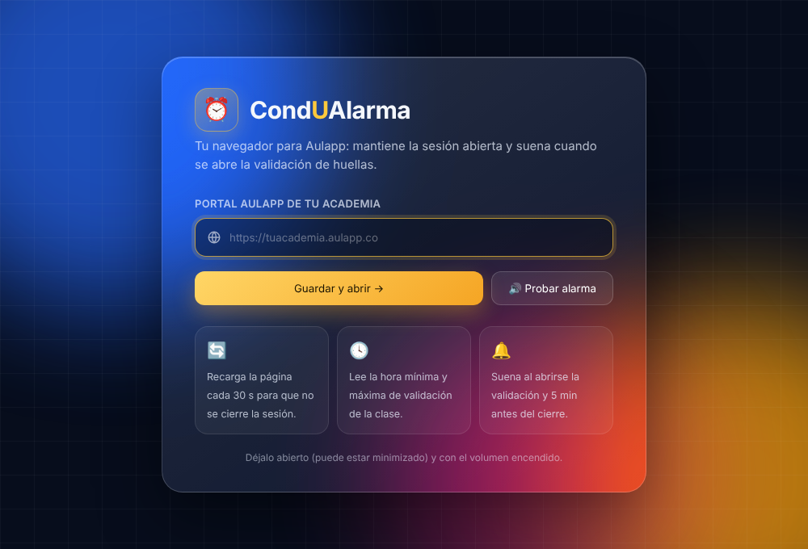
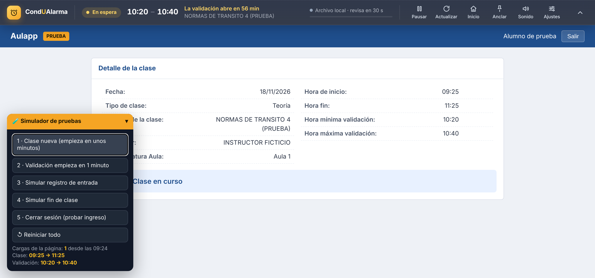
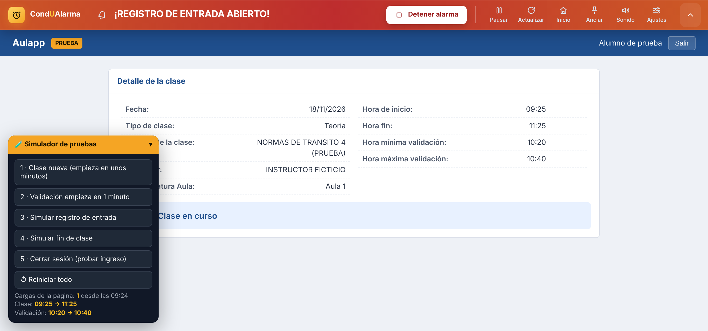

# ⏰ CondUAlarma

Navegador para **Aulapp** (Windows) que mantiene la sesión abierta y hace sonar una alarma cuando se abre la **validación de huellas** de la clase.

## ⬇️ Descargar

Ve a **[Releases](../../releases/latest)** y descarga **`condualarma.exe`**. No necesita instalación: solo ábrelo.

> Windows puede mostrar *"Windows protegió su PC"* porque el programa no está firmado. Pulsa **Más información → Ejecutar de todas formas**.

## Qué hace

- 🔄 **Recarga la página cada 30 s** para que Aulapp no cierre la sesión (espera si estás escribiendo y se puede pausar).
- 🕓 **Lee la clase**: Fecha, Nombre de la clase, *Hora mínima validación* y *Hora máxima validación*.
- 🔔 **Alarma a la hora mínima**: sirena en bucle, la ventana salta al frente y parpadea, y aparece un aviso grande. Se detiene al pulsar **Aceptar**.
- ⏳ **Recordatorio 5 minutos antes** de que cierre la validación.
- 💾 Guarda la URL de tu academia y la sesión, para no volver a iniciar sesión cada vez.

| Pantalla inicial | Panel dentro de Aulapp |
|---|---|
|  |  |



## Uso

1. Abre `condualarma.exe` y pega la dirección del portal Aulapp de tu academia.
2. Inicia sesión y abre la clase del día.
3. Deja CondUAlarma abierto (puede estar minimizado) con el volumen encendido.
4. Pulsa **🔊 Probar** en el panel para comprobar que suena.

**Requisitos:** Windows 10 u 11 de 64 bits con *Microsoft Edge WebView2 Runtime* (ya viene incluido en Windows 10/11).

Los datos se guardan en `%APPDATA%\CondUAlarma`.

## Compilar desde el código

Requiere Go 1.22 o superior (se puede compilar desde Windows, Linux o macOS):

```bash
GOOS=windows GOARCH=amd64 CGO_ENABLED=0 go build -trimpath -ldflags "-H windowsgui -s -w" -o condualarma.exe .
```

Al publicar una etiqueta `v*`, GitHub Actions compila el `.exe` y lo adjunta al release automáticamente.

## Archivos

- `main.go` — ventana, configuración, temporizador de validación y alarma (sonido, aviso, traer al frente).
- `inject.js` — se inyecta en Aulapp: detecta las horas, dibuja el panel y recarga cada 30 s.
- `setup.html` — pantalla inicial para poner la URL.
